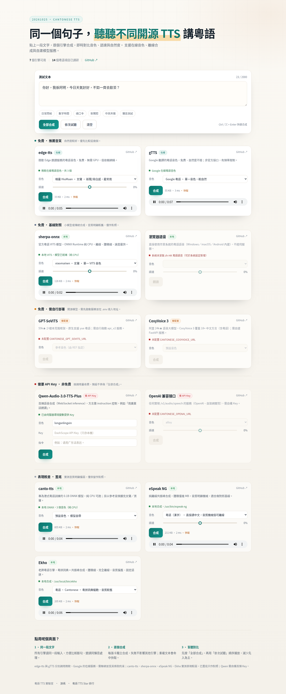

# 粵語 TTS 實驗室 · Cantonese TTS Playground

貼上一段文字，用不同開源 TTS 引擎讀出粵語，即時對比音色、語速與自然度。

A tiny self-hosted web playground for comparing Cantonese text-to-speech engines side by side.



## 為何做這個

GitHub 上「支援粵語」的 TTS 專案不少，但質素、部署成本、粵語處理方式差別很大：有的原生訓練過粵語，有的靠方言指令，有的只是接微軟在線音色，還有的其實只支援普通話。

這個頁面把比較流程固定下來：**同一段文字 → 多個引擎合成 → 順序試聽**，方便快速判斷哪個方案適合自己的場景。

## 功能

- **多引擎並排**：edge-tts、canto-tts、gTTS、sherpa-onnx、eSpeak NG、Ekho、瀏覽器 Web Speech，以及可填 Key 的 Qwen3-TTS，加上可選的 GPT-SoVITS / CosyVoice 3 / OpenAI 兼容服務
- **一鍵全部合成**：逐個引擎排隊合成，任何一個失敗都不影響其他卡片
- **依次試聽**：按順序自動播放，適合做盲聽對比
- **內容哈希快取**：同一段文字 + 同一組參數只合成一次
- **純靜態前端**：HTML/CSS/JS 無構建步驟，後端只有 FastAPI
- **遠端模型適配器**：把自建模型服務接進來，毋須改前端

## 快速開始

需求：Python 3.10+。`espeak-ng`、`ffmpeg` 為可選（前者啟用離線引擎，後者僅用於檢查音頻）。

```bash
git clone https://github.com/leon7786/20261025-Cantonese.git
cd 20261025-Cantonese

python3 -m venv .venv
./.venv/bin/pip install -r requirements.txt

# 可選：離線引擎
sudo apt install espeak-ng        # macOS: brew install espeak-ng
./.venv/bin/pip install -r requirements-canto.txt   # 港式粵語 canto-tts（純 CPU）
./scripts/install-ekho.sh         # 可選：編譯 Ekho（經典粵語引擎，需 sudo）

HOST=127.0.0.1 PORT=8000 ./.venv/bin/python -m app
```

打開 <http://127.0.0.1:8000> 即可。也可以直接用 `./run.sh`（自動建立 venv 並安裝依賴）。

## 已接入引擎

| 引擎 | 類型 | 費用 | 粵語來源 | 開箱可用 |
|---|---|---|---|---|
| [edge-tts](https://github.com/rany2/edge-tts) | 在線 | 免費 | 微軟 `zh-HK` 三個音色（曉曼／曉佳／雲龍） | ✅（需聯網） |
| [canto-tts](https://github.com/typangaa/canto-tts) | 本地 | 免費 | 港式粵語專用模型（MOSS-TTS-Nano 微調），粵拼前端；支援自訂音色 | 安裝後 ✅（首次下載 730 MB） |
| [gTTS](https://github.com/pndurette/gTTS) | 在線 | 免費 | Google 翻譯粵語（`tl=yue`），非官方接口、會限流 | ✅（需聯網） |
| [sherpa-onnx](https://github.com/k2-fsa/sherpa-onnx) | 本地 | 免費 | 官方粵語 VITS（xiaomaiiwn），ONNX Runtime 純 CPU | 安裝後 ✅（首次下載 108 MB） |
| [eSpeak NG](https://github.com/espeak-ng/espeak-ng) | 本地 | 免費 | 內建 `yue` 語音，另有粵拼輸入變體 | 安裝後 ✅ |
| [Ekho](https://github.com/hgneng/ekho) | 本地 | 免費 | 粵拼詞典驅動的經典引擎（Cantonese） | 需編譯：`scripts/install-ekho.sh` |
| 瀏覽器 Web Speech | 本地 | 免費 | 作業系統 `zh-HK` 語音 | 視系統而定 |
| [GPT-SoVITS](https://github.com/RVC-Boss/GPT-SoVITS) | 遠端 | 免費（自架） | `text_lang=yue` + 參考音頻 | 需配置 |
| [CosyVoice 3](https://github.com/FunAudioLLM/CosyVoice) | 遠端 | 免費（自架） | 18+ 中文方言（含粵語） | 需配置 |
| [Qwen-Audio-3.0-TTS-Plus](https://www.alibabacloud.com/help/zh/model-studio/qwen-audio-3-0-tts-plus) | 在線 API | 需 API Key（1.4 元/萬字符） | 百煉 WebSocket inference，`instruction` 控制方言（如「用廣東話朗讀」） | 填 Key 即用 |
| OpenAI 兼容接口 | 遠端 | 需 API Key | 由服務決定 | 需配置 |

頁面按**實測表現**分區排列：**推薦音質（edge-tts / gTTS）→ 基線對照（sherpa-onnx / 瀏覽器）→ 免費但需自行部署 → 需要 API Key → 表現較差置底（canto-tts / eSpeak NG / Ekho）**。

sherpa-onnx 是 108 MB 的小型 VITS，eSpeak NG 與 Ekho 屬上一代共振峰合成，三者音質明顯較舊，放在「基線對照」只作參考；需要 Key 的引擎預設不參與「全部合成」。

## 接入自建模型

複製 `.env.example` 為 `.env` 後填寫，重啟服務生效。未配置的引擎會在頁面上顯示「需配置」，不影響其他引擎。

### GPT-SoVITS

```bash
# 在 GPT-SoVITS 目錄啟動 API
python api_v2.py -a 127.0.0.1 -p 9880 -c GPT_SoVITS/configs/tts_infer.yaml
```

```dotenv
CANTONESE_GPT_SOVITS_URL=http://127.0.0.1:9880
CANTONESE_GPT_SOVITS_REF=/absolute/path/to/reference.wav
CANTONESE_GPT_SOVITS_PROMPT=參考音頻對應的文字（可留空）
```

### CosyVoice 3

```bash
python runtime/python/fastapi/server.py --port 50000 \
  --model_dir pretrained_models/Fun-CosyVoice3-0.5B
```

```dotenv
CANTONESE_COSYVOICE_URL=http://127.0.0.1:50000
CANTONESE_COSYVOICE_SPK=中文女
```

### 其他 OpenAI 兼容服務（如自架 VoxCPM 或網關）

```dotenv
CANTONESE_OPENAI_URL=http://127.0.0.1:9000
CANTONESE_OPENAI_KEY=sk-...
CANTONESE_OPENAI_MODEL=tts-1
CANTONESE_OPENAI_VOICE=alloy
```

## API

| 方法 | 路徑 | 說明 |
|---|---|---|
| `GET` | `/api/health` | 健康檢查 |
| `GET` | `/api/engines?refresh=true` | 引擎清單、可用狀態、音色 |
| `POST` | `/api/tts` | 合成，返回音頻 URL 與耗時 |
| `GET` | `/audio/{name}` | 讀取快取音頻 |

```bash
curl -X POST http://127.0.0.1:8000/api/tts \
  -H 'Content-Type: application/json' \
  -d '{"engine":"edge-tts","text":"你好，我係阿明。","voice":"zh-HK-HiuMaanNeural","rate":0}'
```

```json
{"engine":"edge-tts","voice":"zh-HK-HiuMaanNeural","url":"/audio/5ad8f1541c673891f2a0.mp3",
 "mime":"audio/mpeg","bytes":33984,"ms":1512,"cached":false}
```

錯誤語義：`400` 參數錯、`502` 引擎失敗、`503` 引擎不可用、`504` 合成超時。

## 專案結構

```
app/
  engines/          # 每個專案一個適配器，統一 Engine 介面
    edge.py  espeak.py  gpt_sovits.py  cosyvoice.py  openai_compat.py
  cache.py          # 內容哈希 + 檔案快取
  config.py         # .env 讀取
  main.py           # FastAPI 路由
web/                # 無構建前端（index.html / app.js / styles.css）
scripts/smoke_test.py
docs/
```

新增引擎只需繼承 `app/engines/base.py` 的 `Engine`，實作 `probe()` 與 `synth()`，再註冊到 `app/engines/__init__.py`。

## 粵語 TTS 項目 Star 排行

> 數據抓取於 2026-10-25（GitHub API + Hugging Face API）。只收錄**官方文檔明確支援粵語**的專案，Star 數會變動。

| # | 項目 | Stars | 許可 | 粵語支持方式 |
|---|---|---|---|---|
| 1 | [RVC-Boss/GPT-SoVITS](https://github.com/RVC-Boss/GPT-SoVITS) | 63.7k | MIT | `yue` 原生語言代碼，訓練集含粵語 |
| 2 | [OpenBMB/VoxCPM](https://github.com/OpenBMB/VoxCPM) | 40.6k | Apache-2.0 | VoxCPM2：30 語言 + 9 方言，方言含粵語 |
| 3 | [QwenAudio/CosyVoice](https://github.com/QwenAudio/CosyVoice) | 24.1k | Apache-2.0 | 倉庫 topics 含 `cantonese`；CosyVoice 3 覆蓋 18+ 方言（含粵語） |
| 4 | [k2-fsa/sherpa-onnx](https://github.com/k2-fsa/sherpa-onnx) | 15.5k | Apache-2.0 | 官方 `vits-cantonese` ONNX 模型，可端側 |
| 5 | [PaddlePaddle/PaddleSpeech](https://github.com/PaddlePaddle/PaddleSpeech) | 12.7k | Apache-2.0 | `examples/canton/tts3` 粵語配方 |
| 6 | [rany2/edge-tts](https://github.com/rany2/edge-tts) | 12.4k | 開源客戶端 | 微軟 `zh-HK` 音色 |
| 7 | [eSpeak NG](https://github.com/espeak-ng/espeak-ng) | 7.0k | GPL-3.0 | 內建 `yue` 語音 |
| 8 | [OpenMOSS/MOSS-TTS](https://github.com/OpenMOSS/MOSS-TTS) | 4.2k | Apache-2.0 | 31 語言含 `yue`，官方明示粵語繼續訓練 |
| 9 | [Soul-AILab/SoulX-Podcast](https://github.com/Soul-AILab/SoulX-Podcast) | 3.6k | Apache-2.0 | 支援粵語／四川話／河南話播客 |
| 10 | [Edge0-AI/Audio8_TTS](https://github.com/Edge0-AI/Audio8_TTS) | 1.9k | Apache-2.0 | 語言表含粵語 |
| 11 | [hgneng/ekho](https://github.com/hgneng/ekho) | 1.2k | GPL-2.0 | 粵拼驅動的離線引擎 |
| 12 | [stepfun-ai/Step-Audio-EditX](https://github.com/stepfun-ai/Step-Audio-EditX) | 991 | Apache-2.0 | 零樣本克隆支援粵語，前綴 `[Cantonese]` |
| 13 | [inclusionAI/Ming-3.0-tts](https://github.com/inclusionAI/Ming-3.0-tts) | 251 | MIT | `task="DIALECT"` + `controls={"dialect":"cantonese"}`，0.5B 粵語 CER SOTA |
| 14 | [typangaa/canto-tts](https://github.com/typangaa/canto-tts) | 16 | Apache-2.0 | 港式粵語專用，MOSS-TTS-Nano 微調，ONNX 純 CPU |

### 粵語專用模型（Hugging Face，無 GitHub Star 可比）

| 模型 | 說明 |
|---|---|
| [ASLP-lab/Cosyvoice2-Yue](https://huggingface.co/ASLP-lab/Cosyvoice2-Yue) | 基於 CosyVoice2 的粵語 TTS 基座，Apache-2.0 |
| [ASLP-lab/Cosyvoice2-Yue-ZoengJyutGaai](https://huggingface.co/ASLP-lab/Cosyvoice2-Yue-ZoengJyutGaai) | 上述模型的「更自然」微調版（粵語：將粵嫁） |
| [ASLP-lab/WSYue-TTS](https://huggingface.co/ASLP-lab/WSYue-TTS) | WenetSpeech-Yue 配套粵語 TTS |
| [typangaa/canto-tts-nano](https://huggingface.co/typangaa/canto-tts-nano) | 0.1B 港式粵語權重，粵拼輸入、支援中英夾雜 |

### 未確認 / 不支援粵語（高星但官方語言表沒有）

| 項目 | Stars | 情況 |
|---|---|---|
| microsoft/VibeVoice | 55.0k | 僅中／英 |
| fishaudio/fish-speech | 33.4k | S2 Pro 宣稱 80+ 語言但清單無 `yue`；授權為 Fish Audio Community License（研究／非商用免費，商用需授權） |
| index-tts/index-tts | 24.7k | 語言選項無粵語 |
| QwenLM/Qwen3-TTS | 14.0k | 10 語言 + 北京／四川方言音色，無粵語 |
| High-Logic/Genie-TTS | 1.8k | GPT-SoVITS 的 ONNX 推理引擎，官方語言只列 ja/en/zh/ko，粵語未確認 |

> Star 數反映熱度，不代表粵語效果。榜上第 6／7／11 名本質是在線服務封裝或傳統合成，音質與神經網絡模型不在同一層級。

## canto-tts 的多音色

官方 ONNX bundle 只有一個 baked voice，但 runtime 仍然以 `prompt_audio_codes` 作為條件。這裡用模型自帶的 audio tokenizer 把參考音頻編碼成 codes，每次合成前切換，就得到多個音色：

| 音色 | 來源 |
|---|---|
| 預設音色 | 模型自帶 |
| 女聲 | Common Voice 22 粵語參考（CC0 1.0） |
| 男聲 | Common Voice 22 粵語參考（CC0 1.0） |

參考音頻放在 `assets/voices/*.wav`，**放入新的 48 kHz 立體聲 WAV 就自動多一個音色**（檔名即音色 id，重啟後生效）。

> 這是推理期的條件切換，不是重新訓練；0.1B 模型的克隆能力有限，音色差異主要在音高與音質，咬字仍由同一個聲學模型決定。

## 在頁面填 API Key

Qwen3-TTS 卡片帶一個 Key 輸入框：

- Key 只存在瀏覽器 `localStorage`（`cantonese.key.qwen-tts`），隨請求發給本機後端，**不會寫入伺服器或快取**
- 也可以在 `.env` 設 `CANTONESE_DASHSCOPE_KEY`，頁面留空時使用環境變數
- 走百煉 WebSocket inference：`run-task → task-started → continue-task → finish-task → task-finished`，PCM 拼成 WAV
- 音色可**手動輸入**（3.0-plus 系統音色：`longanlingxin` 女、`longanlufeng` 男）
- 「指令」欄控制方言／情緒／角色，預設 `请用广东话表达。`（官方句式）；留空則用 `CANTONESE_QWEN_INSTRUCTION`
- 相關環境變數：`CANTONESE_QWEN_MODEL`、`CANTONESE_QWEN_VOICE`、`CANTONESE_QWEN_INSTRUCTION`、`CANTONESE_QWEN_LANG_HINTS`、`CANTONESE_QWEN_PROTOCOL`（`ws`/`http`）、`CANTONESE_QWEN_WS_URL`、`CANTONESE_QWEN_WORKSPACE`
- 新舊域名：預設走 `wss://dashscope.aliyuncs.com/api-ws/v1/inference`；百煉建議用業務空間專屬域名 `wss://{WorkspaceId}.cn-beijing.maas.aliyuncs.com/api-ws/v1/inference`，可用 `CANTONESE_QWEN_WS_URL` + `CANTONESE_QWEN_WORKSPACE` 切換
- 北京與新加坡區域的 Key 不通用，預設走北京 `dashscope.aliyuncs.com`
- 需要 Key 的引擎不參與「全部合成」，避免誤觸計費

沒有 Key 也可以測協議：`python scripts/mock_qwen_ws.py` 會起一個本地模擬 realtime 服務（回 1 秒正弦波），再用 `CANTONESE_QWEN_WS_URL=ws://127.0.0.1:8765/api-ws/v1/realtime` 啟動應用即可走完整條鏈路。

> ℹ️ `sk-sp-…` 開頭的 Key 屬 Token Plan / Coding Plan，**不能**用 `dashscope.aliyuncs.com`；它對應的端點是 `token-plan.cn-beijing.maas.aliyuncs.com`（`/compatible-mode/v1` 跑對話，`api-ws/v1/inference` 跑語音），兩者 Key 不互通。
>
> ⚠️ Qwen3-TTS 官方 `language_type` 只有中／英／日／韓／德／法／俄／西／葡／意，**沒有粵語**，粵字會用普通話音色讀。放進來是為了對照「普通話模型讀粵語」的效果。

### 百煉 WebSocket 調用要點

```
wss://dashscope.aliyuncs.com/api-ws/v1/inference      # 或 {WorkspaceId}.cn-beijing.maas.aliyuncs.com
Authorization: Bearer <API_KEY>
```

```jsonc
// 1) run-task
{"header":{"action":"run-task","task_id":"<uuid>","streaming":"duplex"},
 "payload":{"task_group":"audio","task":"tts","function":"SpeechSynthesizer",
  "model":"qwen-audio-3.0-tts-plus",
  "parameters":{"text_type":"PlainText","voice":"longanlingxin","format":"pcm",
                "sample_rate":24000,"volume":50,"rate":1,"pitch":1,
                "enable_ssml":false,"instruction":"请用广东话表达。"},
  "input":{}}}
// 2) 收到 task-started 後
{"header":{"action":"continue-task","task_id":"<uuid>","streaming":"duplex"},"payload":{"input":{"text":"你好"}}}
{"header":{"action":"finish-task","task_id":"<uuid>","streaming":"duplex"},"payload":{"input":{}}}
// 3) 每個 result-generated 事件後跟一幀 binary 音頻；收 task-finished 即完成
```

音色：`longanlingxin`（女）、`longanlufeng`（男），另有 500+ 復刻音色。方言靠 `instruction`，`language_hints` 只有 zh/en/ja 等，**沒有粵語代碼**。費用 1.4 元/萬字符，RPM 180。

## 注意事項

- `edge-tts` 調用微軟在線朗讀服務，需聯網並受其服務條款約束，不適合敏感內容或商用兜底。
- 本專案**不含任何模型權重**，只做調用與對比；離線模型請按各專案說明自行部署。
- 粵語在多數引擎中是「順帶支援」，建議用含懶音、口語詞、中英夾雜的句子實測。
- 合成結果快取在 `.cache/`，可直接刪除。

## License

MIT
